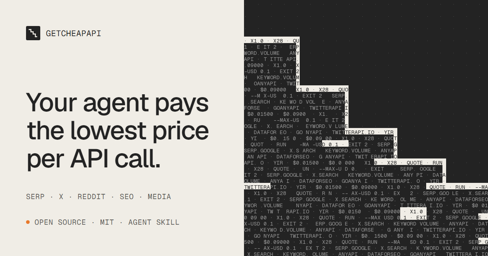

<div align="center">

<a href="https://getcheapapi.com/"></a>

**Your agent compares prices before it calls an API.**

[](LICENSE)
[](pyproject.toml)
[](skills/getcheapapi/SKILL.md)
[](skills/getcheapapi/SKILL.md)
[](https://github.com/getcheapapi/getcheapapi/stargazers)

**English** · [简体中文](README.zh-CN.md) · [Website](https://getcheapapi.com/)

</div>

getcheapapi is a free, open-source skill and CLI for SERP, X, Reddit, keyword, backlink and media APIs. Before each paid call it prices every provider, runs the cheapest one you have a key for, and stops before it goes over your budget.

```text
$ getcheapapi quote keyword.volume --input '{"keywords":["k1","k2","k3","k4","k5"]}'
  goanyapi keyword-search-volume                    $0.01500   x1.0  5 calls   ok
  dataforseo keywords_data/google_ads/search_volume/live  $0.09000   x6.0  1 call    ok
would run: goanyapi keyword-search-volume $0.01500

$ getcheapapi quote keyword.volume --input @50-keywords.json
  dataforseo keywords_data/google_ads/search_volume/live  $0.09000   x1.0  1 call    ok
  goanyapi keyword-search-volume                    $0.15000   x1.7  50 calls  ok
would run: dataforseo keywords_data/google_ads/search_volume/live $0.09000
```

Same request, two sizes: for 5 keywords GoAnyAPI is 6x cheaper; for 50, DataForSEO's batch endpoint wins (they swap at about 30). You do not have to know that. getcheapapi does the comparison on every call, and a quote spends nothing.

## Quick start

### 1. Add the skill to your agent

Paste this into Claude Code, Codex or another coding agent:

```text
Read https://getcheapapi.com/llms.txt and install the getcheapapi skill for this agent by following its install steps.
```

<details>
<summary>Or install it by hand</summary>

```bash
git clone https://github.com/getcheapapi/getcheapapi ~/getcheapapi

# Claude Code
mkdir -p ~/.claude/skills && ln -s ~/getcheapapi/skills/getcheapapi ~/.claude/skills/getcheapapi
# Codex
mkdir -p ~/.agents/skills && ln -s ~/getcheapapi/skills/getcheapapi ~/.agents/skills/getcheapapi
```

On Windows, link it with a directory junction (`mklink /J`, no admin rights needed) rather than copying it: the skill runs from the clone (Python 3.10+). Restart the agent session to load it.

</details>

### 2. Add your keys

```bash
mkdir -p ~/.getcheapapi && curl -fsSL https://raw.githubusercontent.com/getcheapapi/getcheapapi/main/.env.example -o ~/.getcheapapi/.env
```

Fill in the keys you already have in `~/.getcheapapi/.env`. One provider is enough to start. Keep keys in this file, not in the chat with your agent.

### 3. Ask

> "Get the monthly search volume for these 30 keywords."
>
> "Search X for posts about cheap SERP APIs this week."

The agent quotes every route, picks the cheapest, and tells you what it spent.

## What you can ask for

| Capability | What you get | Providers compared |
|---|---|---|
| `serp.google` | Google top 10 results for a query | AnyAPI, DataForSEO, GoAnyAPI |
| `serp.bing` | Bing top 10 results for a query | AnyAPI, GoAnyAPI |
| `x.search` | X (Twitter) search, about 20 posts a page | AnyAPI, twitterapi.io |
| `reddit.search` | Reddit post search, about 25 posts a page | AnyAPI |
| `tiktok.search` | TikTok video search, about 20 videos a page | AnyAPI |
| `google.trends` | Interest over time, up to 5 keywords | AnyAPI, GoAnyAPI |
| `keyword.volume` | Monthly Google search volume for a keyword list | DataForSEO, GoAnyAPI |
| `keyword.ideas` | Keyword ideas around a seed | DataForSEO, GoAnyAPI |
| `backlinks.summary` | Backlink overview of a domain | DataForSEO, GoAnyAPI |
| `domain.rank` / `domain.dr` | Domain rank or Domain Rating for a list of domains | DataForSEO / GoAnyAPI |
| `website.traffic` | Estimated monthly traffic history | GoAnyAPI |
| `image.generate` · `video.generate` · `speech.generate` | Image, video and speech generation | Yir |

Not covered: LLM text routing (use LiteLLM or OpenRouter) and any write action on social accounts.

## How it keeps your bill down

The same data can cost 2x to 200x more depending on the route, and the default route is usually the expensive one. getcheapapi handles the usual traps:

| Trap | What getcheapapi does |
|---|---|
| Aggregators quietly fail over to a dearer source (up to 28x on one X search) | Pins AnyAPI to the cheapest source with failover off, and waits when it is down |
| Options that look harmless raise the price (a search operator: 5x on DataForSEO SERP) | Prices the exact input, options included, before running |
| Billing differs everywhere: per call, per row, per keyword, batches | Dedupes inputs and sends one batch when that is cheaper |
| Prices change | Re-checks prices before spending; stops if the cheapest price jumps |
| Agents keep going: one script sent 211 requests after running out of balance | Refuses runs over `--max-usd` (default $0.10), stops on HTTP 402 or the first failure |

Every call is logged to a local ledger, so `getcheapapi spend` shows where the money went. Routes you have no key for are priced too, so you can see what another key would save.

## Commands

Your agent runs these for you. By hand, `getcheapapi` is `python ~/getcheapapi/skills/getcheapapi/scripts/getcheapapi.py`.

```bash
getcheapapi caps -v                                   # capabilities, inputs, examples
getcheapapi quote serp.google --input '{"query":"cheap serp api"}'   # compare, spends nothing
getcheapapi run serp.google --input '{"query":"cheap serp api"}' --max-usd 0.01
getcheapapi run x.search --input '[{"query":"a"},{"query":"b"}]'      # a list runs as one batch
getcheapapi call dataforseo backlinks/summary/live --input '{"target":"example.com"}'  # raw endpoint, same guards
getcheapapi prices refresh                            # update the local price cache
getcheapapi spend --days 7                            # spend by provider and endpoint
getcheapapi balance anyapi
```

Exit codes for scripts: `0` done, `1` refused or failed (budget, error), `2` out of balance (HTTP 402). On `1` or `2`, stop; do not retry in a loop.

Everything stays in `~/.getcheapapi/` (override with `GETCHEAPAPI_HOME`): keys, price cache, ledger and saved results. Nothing leaves your machine except the API calls themselves.

## Providers

| Provider | Used for | Pricing source |
|---|---|---|
| [AnyAPI](https://getanyapi.com/?via=q89thkytbw) | SERP, X, Reddit, TikTok, Google Trends | live per-source prices |
| [DataForSEO](https://try.dataforseo.com/lhyz26vduxeo) | keyword volume and ideas, backlinks, SERP | published price list |
| [GoAnyAPI](https://goanyapi.com/r/ga-ccef6a6e4f) | SERP, DR, traffic, keyword volume, backlinks | public catalog |
| [twitterapi.io](https://twitterapi.io/?ref=wn7a9fzv) | X search (read only) | published price list |
| [Yir](https://yir.ai/?utm_source=getcheapapi&utm_medium=readme) (same team) | image, video, speech generation | live quotes |

**Disclosure.** Some links above carry our referral code, and the CLI prints them when a key is missing. Yir is run by the same team as getcheapapi. Neither affects routing: routes are ranked by price only.

## Contributing

Prices and endpoints change. To add or fix a route, edit `src/getcheapapi/data/catalog.json`, then:

```bash
python scripts/check_catalog.py   # checks route fields against live provider schemas (free)
python -m pytest
```

## License

[MIT](LICENSE)
