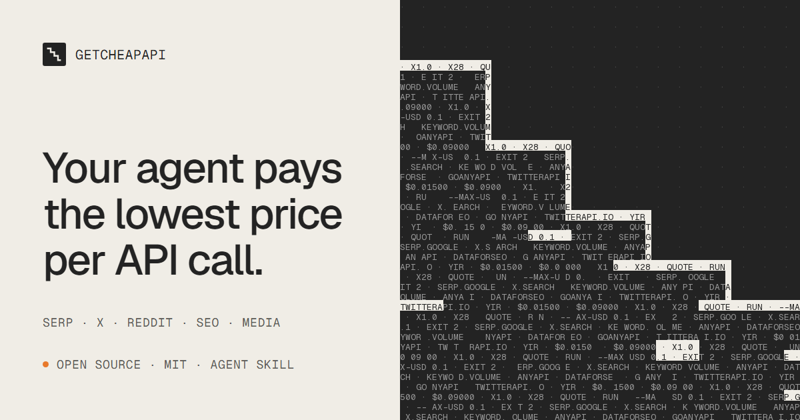

<div align="center">

<a href="https://getcheapapi.com/zh/"></a>

**让你的 Agent 调 API 前先比价。**

[](LICENSE)
[](pyproject.toml)
[](skills/getcheapapi/SKILL.md)
[](skills/getcheapapi/SKILL.md)
[](https://github.com/getcheapapi/getcheapapi/stargazers)

[English](README.md) · **简体中文** · [官网](https://getcheapapi.com/zh/)

</div>

getcheapapi 是一个免费开源的 Skill 和命令行工具，覆盖 SERP、X、Reddit、关键词、外链和媒体生成类 API。每次付费调用前，它先给所有供应商报价，在你有 Key 的供应商里走最便宜的那家，超出预算前就停下。

```text
$ getcheapapi quote keyword.volume --input '{"keywords":["k1","k2","k3","k4","k5"]}'
  goanyapi keyword-search-volume                    $0.01500   x1.0  5 calls   ok
  dataforseo keywords_data/google_ads/search_volume/live  $0.09000   x6.0  1 call    ok
would run: goanyapi keyword-search-volume $0.01500

$ getcheapapi quote keyword.volume --input @50-keywords.json
  dataforseo keywords_data/google_ads/search_volume/live  $0.09000   x1.0  1 call    ok
  goanyapi keyword-search-volume                    $0.15000   x1.7  50 calls  ok
would run: dataforseo keywords_data/google_ads/search_volume/live $0.09000
```

同一个请求，规模不同：查 5 个关键词时 GoAnyAPI 便宜 6 倍；查 50 个时 DataForSEO 的批量接口更划算（分界线大约在 30 个）。这些你不用记，getcheapapi 每次调用都会比一遍，而且报价本身不花钱。

## 快速开始

### 1. 把 Skill 加进你的 Agent

把下面这句话粘贴给 Claude Code、Codex 或其他编程 Agent：

```text
Read https://getcheapapi.com/llms.txt and install the getcheapapi skill for this agent by following its install steps.
```

<details>
<summary>或者手动安装</summary>

```bash
git clone https://github.com/getcheapapi/getcheapapi ~/getcheapapi

# Claude Code
mkdir -p ~/.claude/skills && ln -s ~/getcheapapi/skills/getcheapapi ~/.claude/skills/getcheapapi
# Codex
mkdir -p ~/.agents/skills && ln -s ~/getcheapapi/skills/getcheapapi ~/.agents/skills/getcheapapi
```

Windows 上用目录联接（`mklink /J`，不需要管理员权限），不要复制目录：Skill 要从克隆的仓库里运行（需要 Python 3.10+）。装好后重启 Agent 会话即可加载。

</details>

### 2. 填入你的 Key

```bash
mkdir -p ~/.getcheapapi && curl -fsSL https://raw.githubusercontent.com/getcheapapi/getcheapapi/main/.env.example -o ~/.getcheapapi/.env
```

在 `~/.getcheapapi/.env` 里填上你已有的 Key，有一家就能开始用。Key 只放在这个文件里，不要贴进和 Agent 的对话。

### 3. 直接提需求

> “帮我查这 30 个关键词的月搜索量。”
>
> “搜一下 X 上这周讨论便宜 SERP API 的帖子。”

Agent 会给每条路线报价，选最便宜的执行，最后告诉你花了多少。

## 能查什么

| 能力 | 返回内容 | 参与比价的供应商 |
|---|---|---|
| `serp.google` | 一个查询的 Google 前 10 条结果 | AnyAPI、DataForSEO、GoAnyAPI |
| `serp.bing` | 一个查询的 Bing 前 10 条结果 | AnyAPI、GoAnyAPI |
| `x.search` | X（Twitter）搜索，每页约 20 条 | AnyAPI、twitterapi.io |
| `reddit.search` | Reddit 帖子搜索，每页约 25 条 | AnyAPI |
| `tiktok.search` | TikTok 视频搜索，每页约 20 条 | AnyAPI |
| `google.trends` | 热度随时间变化，最多 5 个关键词 | AnyAPI、GoAnyAPI |
| `keyword.volume` | 一批关键词的 Google 月搜索量 | DataForSEO、GoAnyAPI |
| `keyword.ideas` | 围绕种子词的关键词拓展 | DataForSEO、GoAnyAPI |
| `backlinks.summary` | 一个域名的外链概览 | DataForSEO、GoAnyAPI |
| `domain.rank` / `domain.dr` | 一批域名的 Domain Rank 或 Domain Rating | DataForSEO / GoAnyAPI |
| `website.traffic` | 网站月流量估算历史 | GoAnyAPI |
| `image.generate` · `video.generate` · `speech.generate` | 图片、视频、语音生成 | Yir |

不在范围内：LLM 文本路由（用 LiteLLM 或 OpenRouter），以及社交账号上的任何写操作。

## 它怎么帮你省钱

同样的数据，走不同路线价格能差 2 到 200 倍，而默认路线往往是贵的那条。getcheapapi 帮你绕开这些常见的坑：

| 坑 | getcheapapi 的做法 |
|---|---|
| 聚合商悄悄切到更贵的来源（一次 X 搜索最高差 28 倍） | 把 AnyAPI 固定到最便宜的来源，关闭自动切换 |
| 看似无害的选项会抬价（加个搜索运算符，DataForSEO SERP 贵 5 倍） | 按实际输入（含所有选项）报价，再执行 |
| 各家计费规则不同：按次、按行、按关键词、批量 | 输入去重，批量更便宜时一次发完 |
| 价格会变 | 花钱前再核一次价，最低价突然上涨就停 |
| Agent 不会自己停：有个脚本在余额用完后又发了 211 次请求 | 超过 `--max-usd`（默认 0.1 美元）就拒绝；遇到 HTTP 402 或第一次失败就停 |

每次调用都记入本地账本，`getcheapapi spend` 能看到钱花在了哪。没有 Key 的路线也会报价，让你看到多一个 Key 能省多少。

## 命令

Agent 会替你跑这些命令。手动运行时，`getcheapapi` 即 `python ~/getcheapapi/skills/getcheapapi/scripts/getcheapapi.py`。

```bash
getcheapapi caps -v                                   # 能力列表、输入、示例
getcheapapi quote serp.google --input '{"query":"cheap serp api"}'   # 只比价，不花钱
getcheapapi run serp.google --input '{"query":"cheap serp api"}' --max-usd 0.01
getcheapapi run x.search --input '[{"query":"a"},{"query":"b"}]'      # 传列表就作为一批运行
getcheapapi call dataforseo backlinks/summary/live --input '{"target":"example.com"}'  # 原始接口，同样有护栏
getcheapapi prices refresh                            # 更新本地价格缓存
getcheapapi spend --days 7                            # 按供应商和接口查看花费
getcheapapi balance anyapi
```

脚本可用的退出码：`0` 完成，`1` 被拒绝或失败（超预算、出错），`2` 余额不足（HTTP 402）。遇到 `1` 或 `2` 就停，不要循环重试。

所有数据都在 `~/.getcheapapi/`（可用 `GETCHEAPAPI_HOME` 改位置）：Key、价格缓存、账本和保存的结果。除了 API 调用本身，没有任何数据离开你的机器。

## 供应商

| 供应商 | 用途 | 价格来源 |
|---|---|---|
| [AnyAPI](https://getanyapi.com/?via=q89thkytbw) | SERP、X、Reddit、TikTok、Google Trends | 各来源实时价格 |
| [DataForSEO](https://dataforseo.com) | 关键词搜索量与拓词、外链、SERP | 公开价目表 |
| [GoAnyAPI](https://goanyapi.com/r/ga-ccef6a6e4f) | SERP、DR、流量、关键词搜索量、外链 | 公开目录 |
| [twitterapi.io](https://twitterapi.io/?ref=wn7a9fzv) | X 搜索（只读） | 公开价目表 |
| [Yir](https://yir.ai/?utm_source=getcheapapi&utm_medium=readme)（同一团队） | 图片、视频、语音生成 | 实时报价 |

**披露。** 上表部分链接带有我们的推荐码，缺少 Key 时 CLI 也会打印这些链接。Yir 与 getcheapapi 由同一团队运营。两者都不影响路由：路线只按价格排序。

## 参与贡献

价格和接口会变。要新增或修正路线，编辑 `src/getcheapapi/data/catalog.json`，然后：

```bash
python scripts/check_catalog.py   # 对照供应商实时 schema 检查路线字段（免费）
python -m pytest
```

## 许可证

[MIT](LICENSE)
